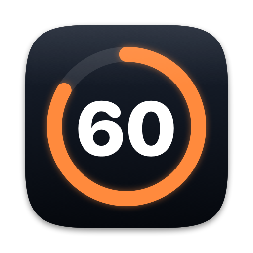

<p align="center"></p>

<h1 align="center">Sixty</h1>

<p align="center"><b>A break reminder for Mac that you cannot skip on autopilot, and that never interrupts a call.</b><br>
After 60 minutes of work, Sixty locks every screen for 60 seconds and shows two short exercises.</p>

<p align="center">
<a href="https://github.com/leplik/sixty/releases/latest">Download</a> ·
<a href="https://leplik.github.io/sixty/">Website</a> ·
<a href="https://leplik.github.io/sixty/ru/">По-русски</a>
</p>

---

Most break reminders have a **Skip** or **Postpone** button. After a week, your hand clicks it before you read the window. Sixty has no such button, no Quit item and no settings. Every 60 minutes you stand up for 60 seconds. If you are in a call, the break waits.

- **Free and open source** (MIT).
- **macOS 14 Sonoma or later**, Apple silicon and Intel.
- **No permissions.** No microphone, camera or Accessibility prompts.
- **No telemetry.** Sixty never records or reads audio. Its only network request is the update check.
- **Updates itself** silently, between breaks.
- **Native and small.** Swift, no third-party code.

## Install

- **Homebrew:** `brew install --cask leplik/tap/sixty`
- **DMG:** download `Sixty-<version>.dmg` from [Releases](https://github.com/leplik/sixty/releases/latest), drag Sixty to Applications and open it once.

Install it in `/Applications` before the first launch. Sixty registers itself as a login agent from that location.

## How it works

```
WORKING ──60 min of work──▶ in a call? ──no──▶ WARNING ──60 s──▶ BREAK ──60 s──▶ WORKING
                               │ yes            ▲
                               ▼                │
                           POSTPONED ───────────┘ call ended + 2 min
```

1. Sixty counts only active time. If you are away for 5 minutes or more, the counter starts again. You already took your break.
2. After 60 minutes, a small countdown appears in the top-right corner for 60 seconds. It has no buttons.
3. Then every screen locks for 60 seconds. An animated figure shows two exercises, 30 seconds each, always done standing. The first one moves the spine and the lower back, which sitting hurts most: standing cat-cow, back bends, pelvic tilts, hip hinges. The second is anything else: squats, calf raises, a walk to the window. Nothing repeats from the previous break.
4. After the minute, you are back where you were.

## Never during a call

Sixty checks every 2 seconds which apps use the microphone, the speaker and the camera. It reads only the "in use" flags that macOS publishes; it never reads audio.

A call is active if:

- any app uses the **camera**, or
- a call app uses the **microphone**: Chrome, Arc, Safari, Edge, Brave, Firefox and other browsers (Google Meet, Jitsi), Teams, Zoom, Slack, Telegram, WhatsApp, FaceTime, Discord, Webex, Signal, Viber, Skype, Granola, or
- a meeting app (Teams, Zoom, Webex, FaceTime) **plays audio**, so a meeting with your microphone muted also counts.

Dictation tools (Handy, Superwhisper, macOS Dictation) and recorders (OBS) are not call apps. They do not postpone a break.

When a break waits, the menu bar shows why: *Break waits: call in Microsoft Teams*. When the call ends, Sixty waits 2 more minutes, then starts the normal countdown.

Your call app is not detected? Run `/Applications/Sixty.app/Contents/MacOS/Sixty --probe` during a call and [open an issue](https://github.com/leplik/sixty/issues) with the output.

## The emergency exit

A real emergency happens. The lock screen shows a phrase of four random words, for example `river candle orbit maple`. Type it and the break ends. The phrase is new every time, so you cannot learn it and type it without thinking. You get two per day.

## Turning Sixty off

There is no Quit item on purpose: Quit can also be clicked on autopilot. Sixty runs as a login agent and starts again if you kill it.

To turn it off on purpose, run this in Terminal:

```sh
/Applications/Sixty.app/Contents/MacOS/Sixty --disable
```

Or switch Sixty off in **System Settings → General → Login Items & Extensions**. To turn it on again, open Sixty.app.

To uninstall: run the command above, then delete Sixty.app. With Homebrew: `brew uninstall --cask sixty`.

## Updates

Sixty updates itself. Twice a day it checks GitHub Releases. If there is a newer version, it downloads it, checks that the developer's Apple Developer ID signed it (team `JVW2N74WL3`), and installs it between two breaks. There is no window and no button. Homebrew knows this (`auto_updates true`), so `brew upgrade` leaves it alone.

## Build from source

Requires Xcode 16 or later (Swift 6).

```sh
make test      # unit tests
make app       # build/Sixty.app, ad-hoc signed
make demo      # 20 s work, 5 s warning, 10 s break; runs in the terminal, Ctrl+C to stop
make probe     # what Sixty sees right now
```

The design is in [docs/SPEC.md](docs/SPEC.md). Contributions are welcome, see [CONTRIBUTING.md](CONTRIBUTING.md).

## Privacy

Sixty has no telemetry and no accounts. It stores the work counter, the next update check and today's breaks in its preferences file. It reads which apps use audio and video devices, but never their content.

Its only network request is the update check: twice a day it asks `api.github.com` for the latest release of this repository. The request carries no data about you, only the `User-Agent: Sixty/<version>` header.

## License

[MIT](LICENSE) © 2026 Aliaksei Smirnou
